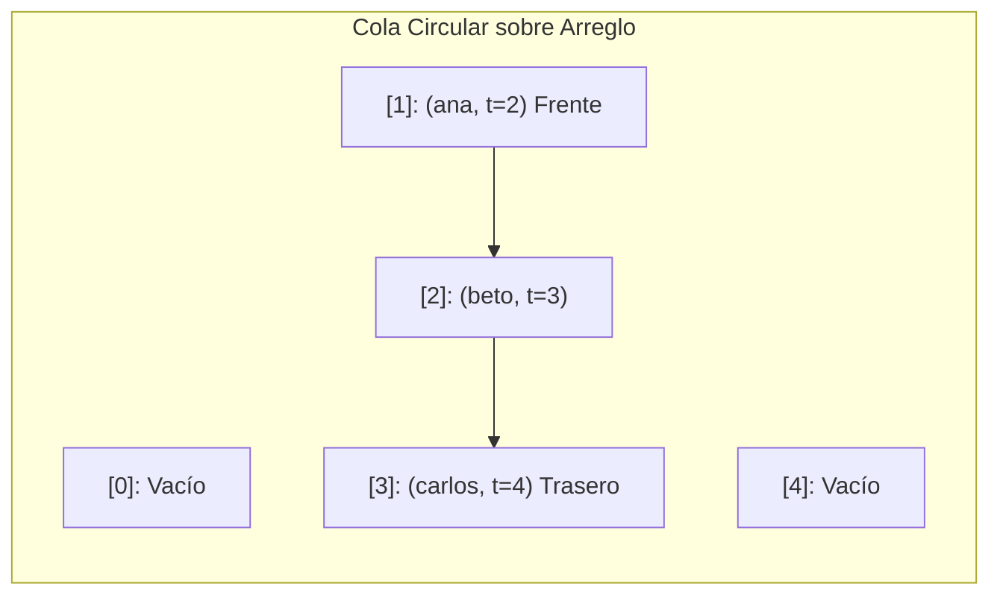

# Informe del avance
En el informe se mostrara lo que se probo y los opstaculos que se tuvieron a la hora de realaizar el avance del proyecto.00
## 1. El escenario

El programa esta planteado para ser utilizado en una clinica, mas precisamente, un programa para organizar los turnos de los pacientes. Seria usado por la recepcion, para que con solo introducir los datos del paciente se incluya en la cola de atencion, a su vez el programa debe consumir muy pocos recursos para que la tecnologia del lugar no caiga, puestos a que es una hubicacion delicada a la hora de hacer tecnologia.

## 2. Qué guarda la estructura y qué operaciones necesita

| Operación | Qué hace | Precondición |
| --- | --- | --- |
| `encolar` | Inserta un nuevo paciente al final de la cola circular guardando su nombre y tiempo de llegada. | La cola no debe estar llena (`cantidad < capacidad`). |
| `desencolar` | Extrae y retorna el paciente que está al frente de la cola para ser atendido. | La cola no debe estar vacía (`cantidad > 0`). |
| `obtenerCantidad` | Retorna el número actual de pacientes esperando en la cola. | Ninguna. |
| `estaLlena` | Verifica si la cantidad actual de elementos es igual a la capacidad máxima. | Ninguna. |
| `estaVacia` | Verifica si la cantidad actual de elementos es cero. | Ninguna. |

## 3. La estructura escogida y por qué

Esta estructura se uso para la optimizacion de los recursos que consume el programa a la hora de realizar una accion, y la otra razon es que con permite organizar de mejor manera los turnos de los pacientes a la hora de agregar uno nuevo. 

Costos esperados, con $n$ el número de elementos:

| Operación | Tiempo | Espacio |
|---|---|---|
| `encolar` | $O(1)$ | $O(1)$ |
| `desencolar` | $O(1)$ | $O(1)$ |
| `obtenerCantidad` | $O(1)$ | $O(1)$ |

El invariante de la estructura, como fórmula:

$$I: \quad 0 \le \text{cantidad} \le \text{capacidad}$$
$$\text{trasero} = (\text{frente} + \text{cantidad} - 1) \pmod{\text{capacidad}}$$

Un diagrama del estado de la estructura, en Mermaid:

## 4. Qué piensan medir

Vamos a variar la cantidad de órdenes de entrada simulando ráfagas de llegada y atención de pacientes desde $10^3$ hasta $10^6$ operaciones. Esperamos ver que el tiempo de ejecución de la cola circular crezca de manera estrictamente lineal respecto al número total de órdenes, confirmando que cada operación individual (encolar y desencolar) se mantiene en un tiempo constante $O(1)$. Posteriormente contrastaremos estos tiempos base con el costo $O(\log n)$ de las operaciones del montículo binario en la entrega final.

## 5. Casos de prueba

| Caso | Entrada | Salida esperada | Salida obtenida |
|---|---|---|---|
| funcional 1 | LLEGA ana 2 - ATIENDE | ana | ana |
| funcional 2 | LLEGA ana 2 - LLEGA beto 5 - ESPERAN | 2 | 2 |
| funcional 3 | LLEGA ana 2 - LLEGA beto 5 - ATIENDE - ATIENDE - PROMEDIO | ana - beto - 3.0 | ana - beto - 3.0 |
| límite | ATIENDE (en inicio) | nadie espera | nadie espera |

Para el caso límite escogimos la estructura vacía. Se simula el intento de ejecutar el comando ATIENDE cuando no hay ningún paciente registrado en la cola circular (frente y trasero indican que cantidad == 0). Esto es vital para comprobar que la lógica de la función desencolar() evalúa correctamente la condición !estaVacia() antes de intentar acceder a un índice de memoria inválido, controlando el flujo para imprimir el mensaje de contingencia esperado por el sistema.
