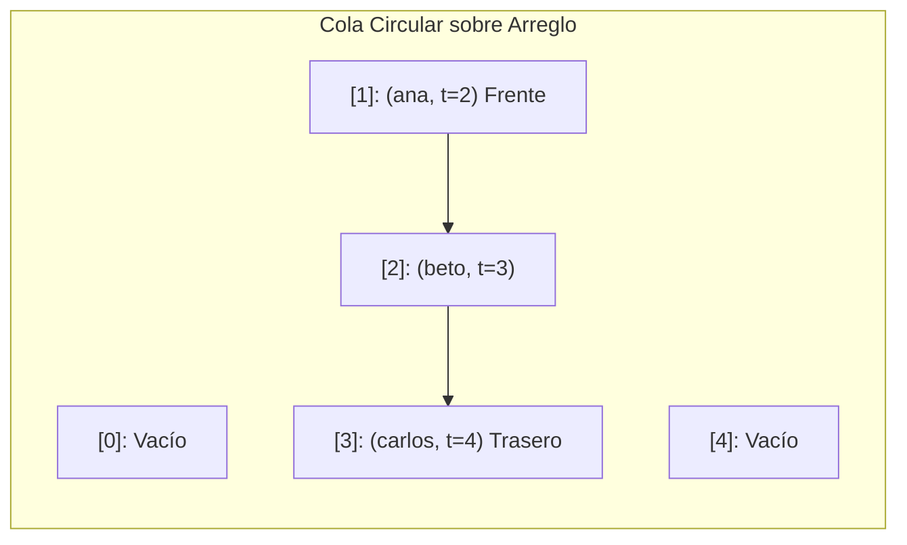

# Informe del avance
En este informe se mostrará lo que se probó y los obstáculos que se tuvieron a la hora de realizar el avance del proyecto.

## 1. El escenario
El programa está planteado para ser utilizado en una clínica, más precisamente, como un sistema para organizar los turnos de los pacientes. Sería usado por la recepción para que, con solo introducir los datos del paciente, este se incluya en la cola de atención. A su vez, el programa debe consumir muy pocos recursos para que el sistema del lugar no colapse, puesto que es una ubicación delicada a la hora de gestionar tecnología.

## 2. Qué guarda la estructura y qué operaciones necesita
| Operación | Qué hace | Precondición |
| --- | --- | --- |
| `encolar` | Inserta un nuevo paciente al final de la cola circular guardando su nombre y tiempo de llegada. | La cola no debe estar llena (`cantidad < capacidad`). |
| `desencolar` | Extrae y retorna el paciente que está al frente de la cola para ser atendido. | La cola no debe estar vacía (`cantidad > 0`). |
| `obtenerCantidad` | Retorna el número actual de pacientes esperando en la cola. | Ninguna. |
| `estaLlena` | Verifica si la cantidad actual de elementos es igual a la capacidad máxima. | Ninguna. |
| `estaVacia` | Verifica si la cantidad actual de elementos es cero. | Ninguna. |

## 3. La estructura escogida y por qué
Esta estructura se usó porque permite organizar los turnos de los pacientes bajo un modelo estricto FIFO (First-In, First-Out) optimizando al máximo los recursos de la clínica. Al ser una cola circular, se reutilizan los espacios de memoria que van quedando libres al inicio del arreglo, lo que evita tener que desplazar los elementos restantes.

Costos esperados, con $n$ el número de elementos:

| Operación | Tiempo | Espacio | Razón del costo en el código |
| :--- | :--- | :--- | :--- |
| `encolar` | $O(1)$ | $O(1)$ | Acceso directo al índice. Se usa aritmética modular `(trasero + 1) % capacidad` para calcular la posición sin usar iteraciones. |
| `desencolar` | $O(1)$ | $O(1)$ | Se extrae el elemento actual y el puntero avanza con la operación matemática `(frente + 1) % capacidad`, sin reacomodar el arreglo. |
| `obtenerCantidad` | $O(1)$ | $O(1)$ | Retorno de valor inmediato. Se consulta directamente la variable estática `cantidad`. |

> **Cita del texto guía:** Tal como se sustenta en CLRS (Cormen, Leiserson, Rivest, Stein), *Introduction to Algorithms, 4.ª ed.*, **Capítulo 10, Sección 10.1 (Stacks and queues)**, la implementación de una cola mediante un arreglo utilizando punteros de frente y trasero permite que las operaciones de inserción y eliminación eviten el desplazamiento de elementos, logrando que el tiempo de ejecución de cada operación sea estrictamente $O(1)$.

El invariante de la estructura, como fórmula:

$$I: \quad 0 \le \text{cantidad} \le \text{capacidad}$$
$$\text{trasero} = (\text{frente} + \text{cantidad} - 1) \pmod{\text{capacidad}}$$

Un diagrama del estado de la estructura, en Mermaid:

## 4. Qué piensan medir

Vamos a variar la cantidad de órdenes de entrada simulando ráfagas de llegada y atención de pacientes desde $10^3$ hasta $10^6$ operaciones. Esperamos ver que el tiempo de ejecución de la cola circular crezca de manera estrictamente lineal respecto al número total de órdenes, confirmando que cada operación individual (encolar y desencolar) se mantiene en un tiempo constante $O(1)$. Posteriormente contrastaremos estos tiempos base con el costo $O(\log n)$ de las operaciones del montículo binario en la entrega final.

## 5. Casos de prueba

| Caso | Entrada | Salida esperada | Salida obtenida |
|---|---|---|---|
| funcional 1 | LLEGA ana 2 -> ATIENDE | ana | ana |
| funcional 2 | LLEGA ana 2 -> LLEGA beto 5 -> ESPERAN | 2 | 2 |
| funcional 3 | LLEGA ana 2 -> LLEGA beto 5 -> ATIENDE -> ATIENDE -> PROMEDIO | ana -> beto -> 3.0 | ana -> beto -> 3.0 |
| funcional 4 | LLEGA elena 4 -> LLEGA fabio 2 -> ESPERAN -> ATIENDE -> PROMEDIO | 2 -> elena -> 3.0 | 2 -> elena -> 3.0 |
| funcional 5 | LLEGA ana 2 -> LLEGA beto 5 -> ESPERAN -> ATIENDE -> ATIENDE -> ESPERAN -> PROMEDIO | 2 -> ana -> beto -> 0 -> 3.0 | 2 -> ana -> beto -> 0 -> 3.0 |
| funcional 6 | LLEGA carlos 3 -> LLEGA diana 5 -> ATIENDE -> ATIENDE | carlos -> diana | carlos -> diana |
| límite | ATIENDE (en inicio) | nadie espera | nadie espera |

Para el caso límite escogimos la estructura vacía. Se simula el intento de ejecutar el comando ATIENDE cuando no hay ningún paciente registrado en la cola circular (frente y trasero indican que cantidad == 0). Esto es vital para comprobar que la lógica de la función desencolar() evalúa correctamente la condición !estaVacia() antes de intentar acceder a un índice de memoria inválido, controlando el flujo para imprimir el mensaje de contingencia esperado por el sistema.
