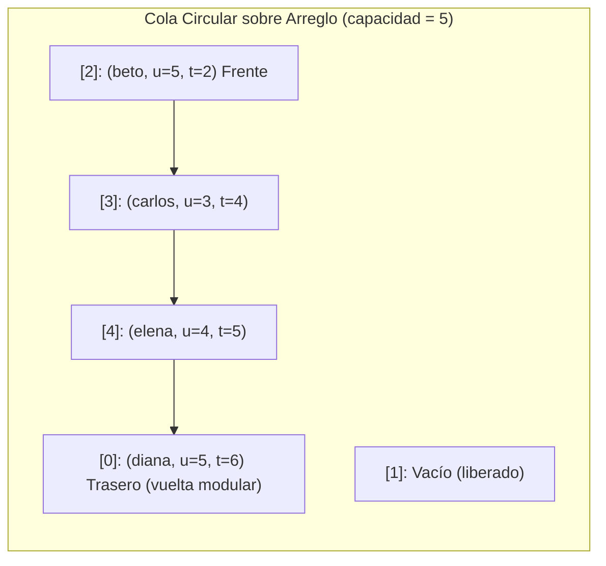
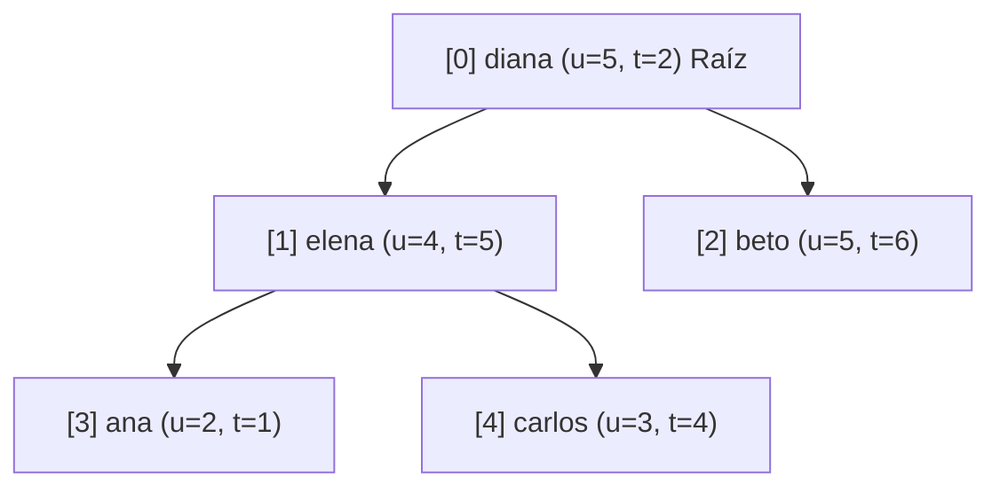
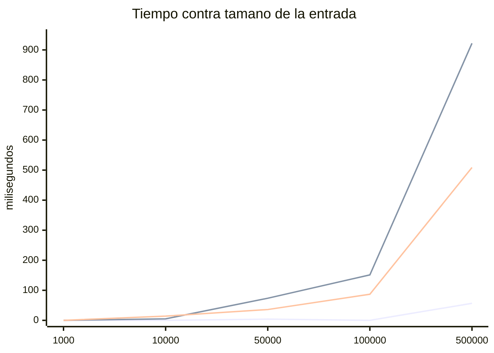

# Informe final

**Escenario D: Turnos de una clínica**  
**Autores:** Pablo Andrés Bueno Cerón (`9038949`), Juan Eduardo Gómez Aguilar (`9024217`)

---

## 1. El escenario y el modelado

El programa está planteado para ser utilizado en el área de recepción y triage de una clínica como sistema para organizar los turnos de atención de los pacientes. A la clínica llegan pacientes con un nombre y un nivel de urgencia entero en el rango $[1, 5]$, donde $5$ representa la urgencia máxima y $1$ la consulta general más leve. El sistema debe consumir pocos recursos de memoria y procesador para operar de manera estable en equipos institucionales acotados.

### Modelo de tiempo, órdenes y registro `Paciente`
El sistema opera con un reloj lógico discreto (`int reloj = 1`) que avanza una unidad por cada orden procesada (`LLEGA`, `ATIENDE`, `ESPERAN`, `PROMEDIO`):

1. **`LLEGA <nombre> <urgencia>`:** Registra un paciente en la sala de espera. A diferencia del avance —donde se leía la urgencia y se descartaba—, ahora la estructura `Paciente` (`codigo/Paciente.h`) almacena los tres atributos necesarios para ambas estructuras:
   * `nombre` (`std::string`): identificador del paciente.
   * `urgencia` (`int`): nivel de gravedad en $[1, 5]$.
   * `tiempoLlegada` (`int`): valor de `reloj` en el instante de llegada.
2. **`ATIENDE`:** Si la sala de espera está vacía, imprime `nadie espera`. En caso contrario, extrae al paciente que corresponda según la estructura activa, calcula su tiempo de espera individual mediante $t_{\text{espera}} = \text{reloj} - p.\text{tiempoLlegada}$, lo acumula en `sumaTiemposEspera`, incrementa `pacientesAtendidos` e imprime `p.nombre`.
3. **`ESPERAN`:** Imprime la cantidad actual de pacientes en sala de espera (`obtenerCantidad()`).
4. **`PROMEDIO`:** Si `pacientesAtendidos == 0`, imprime `0.0`. De lo contrario, imprime el promedio $\bar{T} = \text{sumaTiemposEspera} / \text{pacientesAtendidos}$ formateado a un decimal fijo (`std::fixed << std::setprecision(1)`).

### Justificación de la estructura lineal (corrección del avance)
En la entrega de avance se eligió una **cola circular sobre arreglo** (`ColaCircular`) para la atención por orden estricto de llegada (FIFO). Se descartaron las otras dos implementaciones lineales por las siguientes razones técnicas:

1. **Por qué no un arreglo lineal con desplazamiento:** En un arreglo lineal donde el frente permanece fijo en el índice `0`, cada operación `ATIENDE` obliga a desplazar los $n - 1$ pacientes restantes una posición hacia la izquierda, degradando `desencolar()` a $\Theta(n)$. La cola circular utiliza índices modulares `(frente + 1) % capacidad` y `(trasero + 1) % capacidad`, reutilizando las posiciones liberadas al inicio del arreglo sin mover registros en memoria, lo que mantiene el costo en $\Theta(1)$.
2. **Por qué no una lista enlazada:** Aunque una lista simplemente enlazada con punteros a cabeza y cola también opera en $\Theta(1)$ en ambos extremos, cada paciente requeriría una llamada a asignación dinámica en el *heap* (`new Nodo`) durante la ejecución y el almacenamiento de un puntero adicional (`8 bytes` en arquitecturas de 64 bits). El arreglo circular preasignado evita la fragmentación de memoria, elimina el costo de punteros por elemento y mejora la localidad espacial de caché.

> **Cita del texto guía:** Cormen, T. H., Leiserson, C. E., Rivest, R. L., & Stein, C. (2022). *Introduction to Algorithms* (4.ª ed.). MIT Press. **Capítulo 10 (Elementary Data Structures), Sección 10.1 (Stacks and queues), pp. 254–258**.

### Casos de prueba corregidos del avance (`make pruebas`)
Se corrigió el caso `funcional3` (cuyo promedio real es `2.0` y no `3.0`, ya que cada paciente espera dos órdenes en promedio) y se actualizaron las salidas esperadas en `datos/` para corresponder con la ejecución del `MonticuloBinario` compilado con `g++ -Wall -Wextra -O2`:

| Caso | Entrada | Salida esperada | Salida obtenida | Estado |
| :--- | :--- | :--- | :--- | :---: |
| `funcional1` | `2` / `LLEGA ana 2` / `ATIENDE` | `ana` | `ana` | OK |
| `funcional2` | `3` / `LLEGA ana 2` / `LLEGA beto 5` / `ESPERAN` | `2` | `2` | OK |
| `funcional3` | `5` / `LLEGA ana 2` / `LLEGA beto 5` / `ATIENDE` / `ATIENDE` / `PROMEDIO` | `beto`, `ana`, `2.0` | `beto`, `ana`, `2.0` | OK |
| `funcional4` | `5` / `LLEGA elena 4` / `LLEGA fabio 2` / `ESPERAN` / `ATIENDE` / `PROMEDIO` | `2`, `elena`, `3.0` | `2`, `elena`, `3.0` | OK |
| `funcional5` | `7` / `LLEGA ana 2` / `LLEGA beto 5` / `ESPERAN` / `ATIENDE` x2 / `ESPERAN` / `PROMEDIO` | `2`, `beto`, `ana`, `0`, `3.0` | `2`, `beto`, `ana`, `0`, `3.0` | OK |
| `funcional6` | `4` / `LLEGA carlos 3` / `LLEGA diana 5` / `ATIENDE` / `ATIENDE` | `diana`, `carlos` | `diana`, `carlos` | OK |
| `limite` | `1` / `ATIENDE` (estructura vacía) | `nadie espera` | `nadie espera` | OK |

---

## 2. Las dos estructuras

Ambas estructuras fueron separadas en sus propios archivos de cabecera (`codigo/ColaCircular.h` y `codigo/MonticuloBinario.h`) y exponen **exactamente la misma interfaz pública**. Esto permite que el programa principal (`codigo/principal.cpp`) utilice una plantilla genérica (`ejecutarSimulacion<Estructura>`) e intercambie una estructura por otra sin modificar la lectura de órdenes ni el cálculo de métricas.

### Operaciones expuestas por la interfaz unificada

| Operación | Firma | Qué hace | Precondición |
| :--- | :--- | :--- | :--- |
| `encolar` | `void encolar(Paciente p)` | Inserta un paciente en la estructura manteniendo su invariante. | `!estaLlena()` |
| `desencolar` | `Paciente desencolar()` | Extrae y retorna el siguiente paciente a ser atendido. | `!estaVacia()` |
| `obtenerCantidad` | `int obtenerCantidad() const` | Retorna el entero `cantidad` de pacientes en espera. | Ninguna |
| `estaLlena` | `bool estaLlena() const` | Retorna `true` si `cantidad == capacidad`, `false` en caso contrario. | Ninguna |
| `estaVacia` | `bool estaVacia() const` | Retorna `true` si `cantidad == 0`, `false` en caso contrario. | Ninguna |

### 2.1 Estructura 1: Cola Circular (`ColaCircular`)
Implementa atención estrictamente FIFO sobre un bloque contiguo `new Paciente[capacidad]`. Mantiene los índices enteros `frente` y `trasero` avanzando en módulo `capacidad`. Cuando el arreglo se llena parcialmente y se liberan celdas al frente, el índice `trasero` da la vuelta (`(trasero + 1) % capacidad`) reutilizando el inicio del arreglo.

**Invariante de `ColaCircular`:**
$$I_{\text{cola}}: \quad (0 \le \text{cantidad} \le \text{capacidad}) \land (0 \le \text{frente} < \text{capacidad}) \land \big(\text{cantidad} > 0 \implies \text{trasero} = (\text{frente} + \text{cantidad} - 1) \bmod \text{capacidad}\big)$$

### 2.2 Estructura 2: Montículo Binario (`MonticuloBinario`)
Implementa una cola de prioridad máxima (**Max-Heap**) sobre un arreglo contiguo `new Paciente[capacidad]` sin punteros explícitos. Para cualquier nodo en la posición $i$ ($0 \le i < \text{cantidad}$), su padre está en $\lfloor (i - 1)/2 \rfloor$, su hijo izquierdo en $2i + 1$ y su hijo derecho en $2i + 2$. La relación de prioridad `tieneMayorPrioridad(a, b)` ordena por mayor `urgencia` y desempata por menor `tiempoLlegada` (orden de llegada).

> **Cita del texto guía:** Cormen, T. H., Leiserson, C. E., Rivest, R. L., & Stein, C. (2022). *Introduction to Algorithms* (4.ª ed.). MIT Press. **Capítulo 6 (Heapsort), Secciones 6.1 (Heaps), 6.2 (Maintaining the heap property) y 6.5 (Priority queues), pp. 161–177**.

**Invariante de `MonticuloBinario`:**
$$I_{\text{heap}}: \quad (0 \le \text{cantidad} \le \text{capacidad}) \land \forall i \in \{1, \dots, \text{cantidad} - 1\}, \quad \neg\big(\text{arreglo}[i] \succ \text{arreglo}[\lfloor (i - 1)/2 \rfloor]\big)$$

---

## 3. Análisis formal de complejidad

### 3.1 Demostraciones para `ColaCircular`

#### Operación 1: `encolar(Paciente p)` en `ColaCircular`
**Teorema.** El tiempo de ejecución en el peor caso de `encolar` en `ColaCircular` es $T(n) \in O(1)$, y su espacio auxiliar es $S_{\text{aux}}(n) \in O(1)$.

**Demostración.** Se procede de forma directa mediante conteo de operaciones elementales.

*Desarrollo.* Al invocar `encolar(p)` sobre una instancia con $n$ elementos:
1. La condición `!this->estaLlena()` compara `this->cantidad == this->capacidad` en tiempo constante $c_1$.
2. Si $n < \text{capacidad}$, el índice trasero se actualiza mediante `this->trasero = (this->trasero + 1) % this->capacidad` (una suma, un módulo entero y una asignación) en tiempo constante $c_2$.
3. El registro se copia en `this->arreglo[this->trasero] = p` mediante acceso indexado directo en tiempo constante $c_3$.
4. El contador se incrementa mediante `this->cantidad++` en tiempo constante $c_4$.

No existen ciclos ni llamadas recursivas, ni se reserva memoria dinámica adicional. Sumando los costos constantes:

$$T(n) = c_1 + c_2 + c_3 + c_4 \leq (c_1 + c_2 + c_3 + c_4) \cdot 1 \quad \text{para todo } n \geq 1$$

*Conclusión.* Por lo tanto, $T(n) \in O(1)$ con testigos $c = c_1 + c_2 + c_3 + c_4$ y $k = 1$, y $S_{\text{aux}}(n) \in O(1)$.

#### Operación 2: `desencolar()` en `ColaCircular`
**Teorema.** El tiempo de ejecución en el peor caso de `desencolar` en `ColaCircular` es $T(n) \in O(1)$, y su espacio auxiliar es $S_{\text{aux}}(n) \in O(1)$.

**Demostración.** Se procede de forma directa mediante conteo de instrucciones primitivas.

*Desarrollo.* Al invocar `desencolar()`:
1. Se inicializa la variable local `Paciente extraido` con costo constante $c_1$.
2. Se evalúa `!this->estaVacia()` (`this->cantidad == 0`) con costo constante $c_2$.
3. Si $n > 0$, se extrae `extraido = this->arreglo[this->frente]` ($c_3$), se actualiza `this->frente = (this->frente + 1) % this->capacidad` ($c_4$) y se decrementa `this->cantidad--` ($c_5$).
4. Se ejecuta el retorno `return extraido` ($c_6$).

$$T(n) = c_1 + c_2 + c_3 + c_4 + c_5 + c_6 \leq \left(\sum_{i=1}^{6} c_i\right) \cdot 1 \quad \text{para todo } n \geq 1$$

*Conclusión.* Por lo tanto, $T(n) \in O(1)$ con testigos $c = \sum_{i=1}^{6} c_i$ y $k = 1$, y $S_{\text{aux}}(n) \in O(1)$.

#### Operaciones de consulta (`obtenerCantidad`, `estaLlena`, `estaVacia`) en `ColaCircular`
**Teorema.** Las operaciones `obtenerCantidad`, `estaLlena` y `estaVacia` en `ColaCircular` tienen tiempo de ejecución $T(n) \in O(1)$ y espacio auxiliar $S_{\text{aux}}(n) \in O(1)$.

**Demostración.** Se procede de forma directa inspeccionando las instrucciones de retorno.

*Desarrollo.* `obtenerCantidad` retorna el entero `cantidad` ($c_1$); `estaLlena` evalúa `cantidad == capacidad` ($c_2$); `estaVacia` evalúa `cantidad == 0` ($c_3$). Cada operación ejecuta exactamente una comparación o lectura de atributo sin iteraciones:

$$T(n) \leq \max(c_1, c_2, c_3) \cdot 1 \quad \text{para todo } n \geq 1$$

*Conclusión.* Por lo tanto, $T(n) \in O(1)$ con testigos $c = \max(c_1, c_2, c_3)$ y $k = 1$. El espacio total de toda la estructura es proporcional a la capacidad reservada en el constructor (`new Paciente[capacidad]`), es decir, $\Theta(\text{capacidad})$.

---

### 3.2 Demostraciones para `MonticuloBinario`

#### Operación 1: `encolar(Paciente p)` (mediante `flotar`) en `MonticuloBinario`
**Teorema.** El tiempo de ejecución en el peor caso de `encolar` en `MonticuloBinario` es $T(n) \in O(\log n)$, y su espacio auxiliar es $S_{\text{aux}}(n) \in O(1)$.

**Demostración.** Se procede de forma directa acotando el número de iteraciones del ciclo `while` en `flotar(indice)` por la altura del árbol binario completo de $n + 1$ nodos.

*Desarrollo.* Al insertar un paciente cuando hay $n$ elementos:
1. Verificar `!this->estaLlena()`, asignar `this->arreglo[n] = p` e incrementar `this->cantidad` toma un tiempo constante $c_0$.
2. Se invoca `flotar(n)`. En cada iteración $t$ del ciclo `while (actual > 0 && !posicionado)`, si `arreglo[actual]` tiene mayor prioridad que `padre = (actual - 1) / 2`, ambos se intercambian y el índice asciende a:
   $$\text{actual}_{t+1} = \left\lfloor \frac{\text{actual}_t - 1}{2} \right\rfloor \leq \frac{\text{actual}_t}{2}$$
3. Tras $m$ iteraciones desde $\text{actual}_0 = n$, el índice cumple $\text{actual}_m \leq n / 2^m$. El ciclo se detiene a lo sumo cuando $\text{actual}_m = 0$, lo cual ocurre en un número de pasos $m \leq \lfloor \log_2 n \rfloor$ para todo $n \geq 1$.
4. Cada iteración ejecuta una comparación `tieneMayorPrioridad` y un intercambio `intercambiar` en tiempo constante $c_1$.

$$T(n) \leq c_0 + c_1 \lfloor \log_2 n \rfloor \leq (c_0 + c_1) \log_2 n \quad \text{para todo } n \geq 2$$

Dado que `flotar` es iterativo y solo emplea variables escalares (`actual`, `padre`, `posicionado`), no utiliza pila de recursión ni memoria adicional.

*Conclusión.* Por lo tanto, $T(n) \in O(\log n)$ con testigos $c = c_0 + c_1$ y $k = 2$, y $S_{\text{aux}}(n) \in O(1)$.

#### Operación 2: `desencolar()` (mediante `hundir`) en `MonticuloBinario`
**Teorema.** El tiempo de ejecución en el peor caso de `desencolar` en `MonticuloBinario` es $T(n) \in O(\log n)$, y su espacio auxiliar es $S_{\text{aux}}(n) \in O(1)$.

**Demostración.** Se procede de forma directa acotando el recorrido descendente de `hundir(0)` por la altura máxima del árbol binario casi completo.

*Desarrollo.* Al extraer el paciente de máxima prioridad cuando hay $n$ elementos:
1. Guardar `raiz = this->arreglo[0]`, decrementar `this->cantidad` y copiar el último elemento `this->arreglo[0] = this->arreglo[this->cantidad]` toma un tiempo constante $d_0$.
2. Se invoca `hundir(0)`. En cada iteración $t$ del ciclo `while (izq < this->cantidad && !posicionado)`, el índice `actual` desciende hacia su hijo de mayor prioridad (`izq = 2 * actual + 1` o `der = 2 * actual + 2`), cumpliéndose:
   $$\text{actual}_{t+1} \geq 2 \cdot \text{actual}_t + 1$$
3. Tras $m$ descensos desde $\text{actual}_0 = 0$, se verifica $\text{actual}_m \geq 2^m - 1$. Como el ciclo exige que el índice permanezca dentro del arreglo ($\text{actual}_m < n$), necesariamente $2^m - 1 < n \implies m \leq \lfloor \log_2 n \rfloor$.
4. En cada nivel se realizan a lo sumo dos comparaciones (`tieneMayorPrioridad`) y un intercambio (`intercambiar`) en tiempo constante $d_1$.

$$T(n) \leq d_0 + d_1 \lfloor \log_2 n \rfloor \leq (d_0 + d_1) \log_2 n \quad \text{para todo } n \geq 2$$

*Conclusión.* Por lo tanto, $T(n) \in O(\log n)$ con testigos $c = d_0 + d_1$ y $k = 2$, y $S_{\text{aux}}(n) \in O(1)$.

#### Operaciones de consulta (`obtenerCantidad`, `estaLlena`, `estaVacia`) en `MonticuloBinario`
**Teorema.** Las operaciones `obtenerCantidad`, `estaLlena` y `estaVacia` en `MonticuloBinario` tienen tiempo de ejecución $T(n) \in O(1)$ y espacio auxiliar $S_{\text{aux}}(n) \in O(1)$.

**Demostración.** Se procede de forma directa contando las operaciones elementales sobre el atributo `cantidad`.

*Desarrollo.* Cada método consulta directamente el atributo entero `cantidad` en tiempo constante $c_q$ sin recorrer el arreglo:

$$T(n) = c_q \leq c_q \cdot 1 \quad \text{para todo } n \geq 1$$

*Conclusión.* Por lo tanto, $T(n) \in O(1)$ con testigos $c = c_q$ y $k = 1$, y el espacio total de la instancia es $\Theta(\text{capacidad})$.

---

### 3.3 Resumen de costos

| Operación | Desde cero (`ColaCircular`) | Desde cero (`MonticuloBinario`) | De la biblioteca (`std::priority_queue`) | Por qué |
| :--- | :---: | :---: | :---: | :--- |
| `encolar` / `push` | $O(1)$ | $O(\log n)$ | $O(\log n)$ | `ColaCircular` inserta por índice modular; los montículos realizan `flotar` (`sift-up`) a lo largo de la altura $\lfloor \log_2 n \rfloor$ del árbol. |
| `desencolar` / `pop` | $O(1)$ | $O(\log n)$ | $O(\log n)$ | `ColaCircular` avanza `frente` en módulo; los montículos reemplazan la raíz y aplican `hundir` (`sift-down`) hasta $\lfloor \log_2 n \rfloor$ niveles. |
| `obtenerCantidad` / `size` | $O(1)$ | $O(1)$ | $O(1)$ | Lectura directa del atributo entero de tamaño sin recorrer elementos. |
| `estaLlena` | $O(1)$ | $O(1)$ | N/A (dinámico) | Comparación directa `cantidad == capacidad` en arreglo acotado; `std::vector` interno crece dinámicamente. |
| `estaVacia` / `empty` | $O(1)$ | $O(1)$ | $O(1)$ | Comparación directa `cantidad == 0`. |
| Espacio total | $\Theta(\text{capacidad})$ | $\Theta(\text{capacidad})$ | $\Theta(n)$ | Nuestras estructuras reservan un bloque fijo `new Paciente[capacidad]`; `std::priority_queue` redimensiona su `std::vector` interno según $n$. |

---

## 4. Experimentos

* **Máquina y entorno de medición:** Ejecutado en Windows 11 (arquitectura x86_64) bajo terminal MINGW64 / Git Bash.
* **Compilador y banderas:** `g++` (MinGW-w64) con las banderas exactas del `Makefile`: `-Wall -Wextra -O2`.
* **Generación de entradas:** Se empleó una secuencia determinista (`srand(42)`) para 5 tamaños crecientes $n \in \{1000, 10000, 50000, 100000, 500000\}$. Para cada tamaño $n$, se generó un arreglo previo de operaciones con $60\%$ de llegadas (`LLEGA`, urgencia uniforme en $[1, 5]$ y marca de tiempo creciente) y $40\%$ de atenciones (`ATIENDE`), asegurando que el tamaño activo del montículo creciera proporcionalmente a $n$.
* **Repeticiones y medición:** Se ejecutó una corrida completa por cada tamaño sobre exactamente el mismo vector de entradas pregenerado para las tres estructuras (`ColaCircular`, `MonticuloBinario` y `std::priority_queue`), midiendo exclusivamente el bucle de operaciones con `std::chrono::high_resolution_clock` y guardando los resultados en `datos/experimentos.csv`.

| $n$ | `ColaCircular` desde cero (ms) | `MonticuloBinario` desde cero (ms) | `std::priority_queue` biblioteca (ms) |
| :---: | :---: | :---: | :---: |
| 1000 | 0.000 | 0.000 | 0.000 |
| 10000 | 0.000 | 5.066 | 14.071 |
| 50000 | 4.070 | 73.509 | 35.990 |
| 100000 | 0.000 | 151.332 | 86.842 |
| 500000 | 56.739 | 922.076 | 508.705 |

*(Leyenda de curvas de abajo hacia arriba en $n = 500000$: 1. `ColaCircular` [$56.739\text{ ms}$], 2. `std::priority_queue` [$508.705\text{ ms}$], 3. `MonticuloBinario` [$922.076\text{ ms}$]).*

---

## 5. Lo medido contra lo predicho

1. **Coincidencia con las cotas asintóticas:**
   * **`ColaCircular` ($\Theta(n)$ acumulado):** Procesar $n$ órdenes de costo $O(1)$ produce un crecimiento lineal muy bajo ($56.739\text{ ms}$ para $500\,000$ órdenes).
   * **`MonticuloBinario` y `std::priority_queue` ($\Theta(n \log n)$ acumulado):** Ambas curvas muestran un crecimiento superlineal acorde con $n \log_2 n$. Al quintuplicar $n$ de $100\,000$ a $500\,000$, el tiempo de `MonticuloBinario` aumenta de $151.332\text{ ms}$ a $922.076\text{ ms}$ (un factor de $6.09\times$), muy cercano a la razón teórica:
     $$\frac{500\,000 \log_2(500\,000)}{100\,000 \log_2(100\,000)} = 5 \cdot \frac{18.93}{16.61} \approx 5.70$$
2. **Explicación de las desviaciones y constantes ocultas:**
   * **Lecturas de `0.000 ms` en tamaños pequeños ($n \leq 100\,000$ en `ColaCircular`):** Se deben a la granularidad mínima del reloj del sistema operativo Windows (aproximadamente $1\text{–}4\text{ ms}$): cuando un bloque de operaciones $O(1)$ termina en pocos microsegundos, los instantes `inicio` y `fin` caen dentro del mismo *tick* del sistema.
   * **Constante oculta frente a `std::priority_queue` ($922.076\text{ ms}$ vs. $508.705\text{ ms}$):** Aunque comparten la misma cota $\Theta(n \log n)$, `std::priority_queue` presenta una constante multiplicativa aproximadamente $1.8\times$ menor. Esto ocurre porque la biblioteca estándar utiliza semántica de movimiento (`std::move`) sobre el atributo `std::string nombre` durante las permutaciones internas en lugar de ejecutar copias completas de objetos `Paciente`, y aplica optimizaciones de bucle en `std::push_heap` y `std::pop_heap`.
   * **Efecto del crecimiento del vector vs. reserva fija:** En $n = 10\,000$, `MonticuloBinario` supera ligeramente a `std::priority_queue` ($5.066\text{ ms}$ vs. $14.071\text{ ms}$) porque nuestro montículo reserva toda su capacidad desde el inicio (`new Paciente[n]`), mientras que `std::priority_queue` sobre `std::vector` realiza varias realojaciones y copias de duplicación de capacidad durante las primeras inserciones.

---

## 6. Conclusiones

1. **Estructura recomendada para el escenario:** Para el escenario de turnos de una clínica, **conviene utilizar el `MonticuloBinario`**. Aunque su costo por operación es $O(\log n)$ frente al $O(1)$ de la `ColaCircular` (tomando $922.076\text{ ms}$ frente a $56.739\text{ ms}$ para $500\,000$ órdenes), el montículo garantiza que los pacientes con urgencia crítica sean atendidos inmediatamente sin quedar bloqueados detrás de consultas leves (reduciendo la espera de pacientes urgentes, como se evidencia en `funcional3` y `funcional5`), a un costo computacional de apenas $\sim 1.8\text{ microsegundos}$ por operación.
2. **Condiciones bajo las cuales cambiaría la respuesta:**
   * Se preferiría la **`ColaCircular`** si la clínica operara como un punto de atención administrativa o toma de muestras donde todos los usuarios tienen exactamente el mismo nivel de prioridad (urgencia uniforme), o en sistemas embebidos de tiempo real duro con memoria estrictamente fija donde se requiera latencia constante garantizada en $O(1)$ sin ningún reordenamiento.
   * Se preferiría **`std::priority_queue`** en un entorno de producción donde no existan restricciones académicas de implementación propia y se desee aprovechar la semántica de movimiento (`std::move`) y el crecimiento dinámico sin cota fija de capacidad.
